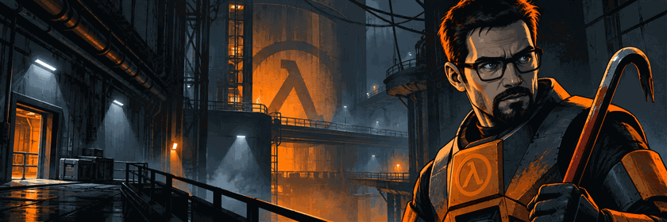

# Manuel Casinos Pérez

**Desarrollador full stack junior · Valencia**

Terminé DAW y sigo aprendiendo con proyectos propios, del frontend al backend.

## Proyectos

### 🎮 [ValveDex](https://github.com/Manuelklk03/ValveDex)

Enciclopedia interactiva de los juegos de Valve. Estoy desarrollando primero el universo Half-Life y sus expansiones.

**Stack:** `React` · `Next.js` · `TypeScript` · `Tailwind CSS` · `Three.js` · `GSAP`

  
  

### 📡 [PulseWatch](https://github.com/Manuelklk03/PulseWatch)

Plataforma en construcción para monitorizar webs y APIs, guardar tiempos de respuesta y gestionar incidencias. Por ahora he documentado la arquitectura y preparado la base del frontend.

**Stack:** `React` · `TypeScript` · `Vite` · `Python` · `FastAPI` · `PostgreSQL` · `Docker`

### 🏋️ [Digital Fit](https://github.com/Manuelklk03/Digital-Fit-Proyecto)

Aplicación para organizar entrenamientos, encontrar lugares donde entrenar y seguir el progreso. Nació como proyecto de DAW y está en renovación hacia su versión 2.0.

**Stack:** `Angular` · `TypeScript` · `Leaflet` · `Java` · `Spring Boot` · `PostgreSQL` · `Docker` · `Maven`

  
  

### 🌐 [Portfolio personal](https://github.com/Manuelklk03/PortFolio-Personal)

Mi portfolio en Astro. Todavía está en desarrollo.

**Stack:** `Astro` · `React` · `TypeScript` · `Tailwind CSS` · `Three.js`

## Tecnologías

### Con las que ya trabajo

### En las que estoy profundizando

### Herramientas que uso en mis proyectos

## Cómo trabajo

En mis repositorios intento cuidar también el proceso:

- **Git y pull requests:** cambios acotados en ramas antes de llevarlos a `main`.
- **Documentación:** pasos para arrancar el proyecto y decisiones importantes.
- **Tests:** estoy incorporando pruebas para detectar errores y evitar regresiones.
- **DevOps y calidad:** Docker, GitHub Actions y SonarQube Cloud para automatizar comprobaciones y revisar el código.

## Contacto

