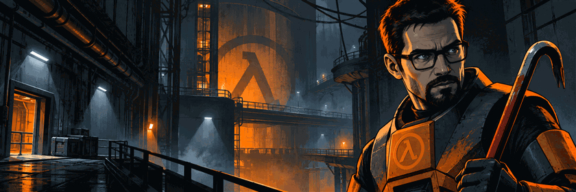

<h1></h1>

**Desarrollador web full stack junior · Valencia**

Construyo aplicaciones web de principio a fin, desde la interfaz hasta la API y los datos. Vengo de Java, Spring Boot y Angular, y en mis proyectos actuales trabajo también con React, Next.js y TypeScript.

     

## Proyectos

### 🎮 [ValveDex](https://github.com/Manuelklk03/ValveDex)

Enciclopedia interactiva de los juegos de Valve. Estoy desarrollando primero el universo Half-Life y sus expansiones.

**Stack:** [React](https://react.dev) · [Next.js](https://nextjs.org/docs) · [TypeScript](https://www.typescriptlang.org/docs/) · [Tailwind CSS](https://tailwindcss.com/docs) · [Three.js](https://threejs.org/docs/) · [GSAP](https://gsap.com/docs/v3/)

  
  
  
  
  
  

### 📡 [PulseWatch](https://github.com/Manuelklk03/PulseWatch)

Plataforma en construcción para monitorizar webs y APIs, guardar tiempos de respuesta y gestionar incidencias.

**Stack:** [React](https://react.dev) · [TypeScript](https://www.typescriptlang.org/docs/) · [Vite](https://vite.dev/guide/) · [Python](https://docs.python.org/3/) · [FastAPI](https://fastapi.tiangolo.com) · [PostgreSQL](https://www.postgresql.org/docs/) · [Docker](https://docs.docker.com)

  
  
  
  
  
  
  

Ver arquitectura y estado de PulseWatch

He documentado la arquitectura y preparado la base del frontend. El diseño separa la API del proceso que comprueba los servicios y guarda los resultados en PostgreSQL.

- [Arquitectura](https://github.com/Manuelklk03/PulseWatch/blob/main/docs/architecture.md)
- [Hoja de ruta](https://github.com/Manuelklk03/PulseWatch#hoja-de-ruta)

### 🛠️ [PartePro](https://github.com/Manuelklk03/PartePro)

Proyecto para gestionar avisos e intervenciones de técnicos a domicilio: asignar visitas, registrar el trabajo y entregar un parte al cliente.

**Stack previsto:** [Vue 3](https://vuejs.org/guide/introduction.html) · [TypeScript](https://www.typescriptlang.org/docs/) · [Vite](https://vite.dev/guide/) · [Java](https://dev.java/learn/) · [Spring Boot](https://docs.spring.io/spring-boot/) · [PostgreSQL](https://www.postgresql.org/docs/) · [Docker](https://docs.docker.com)

  
  
  
  
  
  
  

Ver arquitectura y estado de PartePro

Estoy empezando por la documentación y el entorno de desarrollo. La aplicación ejecutable y la demo siguen pendientes.

- [Estado actual](https://github.com/Manuelklk03/PartePro/blob/main/docs/STATUS.md)
- [Arquitectura propuesta](https://github.com/Manuelklk03/PartePro/blob/main/docs/arquitectura.md)

### 🏋️ [Digital Fit](https://github.com/Manuelklk03/Digital-Fit-Proyecto)

Aplicación para organizar entrenamientos, encontrar lugares donde entrenar y seguir el progreso. Nació como proyecto de DAW y está en renovación hacia su versión 2.0.

**Stack:** [Angular](https://angular.dev) · [TypeScript](https://www.typescriptlang.org/docs/) · [Leaflet](https://leafletjs.com/reference.html) · [Java](https://dev.java/learn/) · [Spring Boot](https://docs.spring.io/spring-boot/) · [PostgreSQL](https://www.postgresql.org/docs/) · [Docker](https://docs.docker.com) · [Maven](https://maven.apache.org/guides/)

  
  
  
  
  
  
  
  

### 🌐 [Portfolio personal](https://github.com/Manuelklk03/PortFolio-Personal)

Mi portfolio con estética de Matrix, arte ASCII, una intro con Morfeo y una terminal interactiva. La versión v1.0 ya está publicada e incluye mis proyectos, mi perfil y mi CV.

**Stack:** [Astro](https://docs.astro.build) · [React](https://react.dev) · [TypeScript](https://www.typescriptlang.org/docs/) · [Tailwind CSS](https://tailwindcss.com/docs) · [Three.js](https://threejs.org/docs/)

  
  
  
  
  

## Sobre mí

Me formé en **Desarrollo de Aplicaciones Web** y busco mi primer puesto como desarrollador. Me interesa tanto lo que la persona ve y usa como lo que hay detrás para que funcione.

<strong>Mi formación y mi primer proyecto full stack</strong>

Digital Fit nació como mi proyecto final de DAW. Lo usé para conectar Angular con una API en Spring Boot y PostgreSQL, e incorporar mapas con Leaflet. Ahora me sirve de base para trabajar en la versión 2.0.

[Ver el código de Digital Fit](https://github.com/Manuelklk03/Digital-Fit-Proyecto) · [Ver mi stack](#tecnologías)

<strong>Una web publicada para un cliente real</strong>

Cerrajería NOA es una web que presenta los servicios y trabajos del negocio en tres idiomas, con acceso directo al contacto.

[Ver la web de Cerrajería NOA](https://cerrajerianoa.es/es)

<strong>Qué estoy aprendiendo y cómo trabajo</strong>

En ValveDex practico interfaces con React, Next.js y TypeScript. En PulseWatch estoy trabajando el otro lado del problema, con decisiones de API, datos y comprobaciones en segundo plano. Documento el alcance, separo los cambios en ramas y reviso las pull requests antes de integrarlas.

[Ver actividad de los proyectos](#qué-estoy-haciendo-ahora) · [Cómo trabajo](#cómo-trabajo) · [Contactar](#contacto)

## Qué estoy haciendo ahora

Cada desplegable muestra el foco del proyecto y dónde seguirlo. Las insignias se actualizan con la actividad de GitHub y abren el historial de commits o las pull requests.

<strong>ValveDex</strong> · Ampliar el universo Half-Life

**En qué estoy trabajando.** Ampliar las fichas de Half-Life, Opposing Force y Blue Shift con personajes, enemigos y mapas.

**Dónde seguirlo.** El estado del repositorio recoge el punto de partida y el roadmap ordena las siguientes incorporaciones.

 

[Estado del desarrollo](https://github.com/Manuelklk03/ValveDex/blob/main/docs/STATUS.md) · [Roadmap](https://github.com/Manuelklk03/ValveDex/blob/main/docs/roadmap.md)

<strong>PulseWatch</strong> · Preparar la base de la monitorización

**En qué estoy trabajando.** Preparar el primer recorrido, desde registrar un monitor HTTP hasta consultar sus resultados. La arquitectura separa la API del proceso que comprueba los servicios.

 

[Hoja de ruta](https://github.com/Manuelklk03/PulseWatch#hoja-de-ruta)

<strong>PartePro</strong> · Definir el flujo de trabajo de los técnicos

**En qué estoy trabajando.** Definir el flujo completo de un aviso, desde asignar la visita hasta registrar el trabajo y entregar el parte al cliente. El repositorio recoge el alcance y los siguientes pasos.

 

[Estado actual](https://github.com/Manuelklk03/PartePro/blob/main/docs/STATUS.md)

<strong>Digital Fit</strong> · Renovar el proyecto de DAW hacia la versión 2.0

**En qué estoy trabajando.** Renovar mi proyecto de DAW hacia la versión 2.0. El punto de partida reúne entrenamientos, lugares donde entrenar y seguimiento del progreso.

 

[Ver repositorio](https://github.com/Manuelklk03/Digital-Fit-Proyecto)

<strong>Portfolio personal</strong> · Actualizar la presentación de mis proyectos

**En qué estoy trabajando.** Mantener al día las fichas de proyectos y mejorar la navegación de la web publicada.

 

[Ver documentación](https://github.com/Manuelklk03/PortFolio-Personal)

## Tecnologías

### Con las que ya trabajo

### En las que estoy profundizando

### Herramientas que uso en mis proyectos

## Cómo trabajo

En mis repositorios intento cuidar también el proceso:

- **Git y pull requests:** cambios acotados en ramas antes de llevarlos a `main`.
- **Documentación:** pasos para arrancar el proyecto y decisiones importantes.
- **Tests:** estoy incorporando pruebas para detectar errores y evitar regresiones.
- **DevOps y calidad:** Docker, GitHub Actions y SonarQube Cloud para automatizar comprobaciones y revisar el código.

## Contacto

